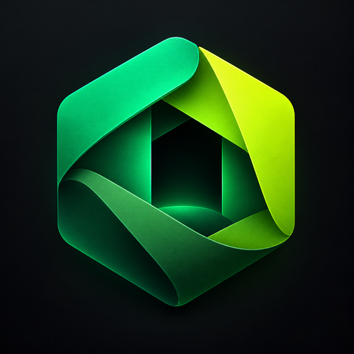
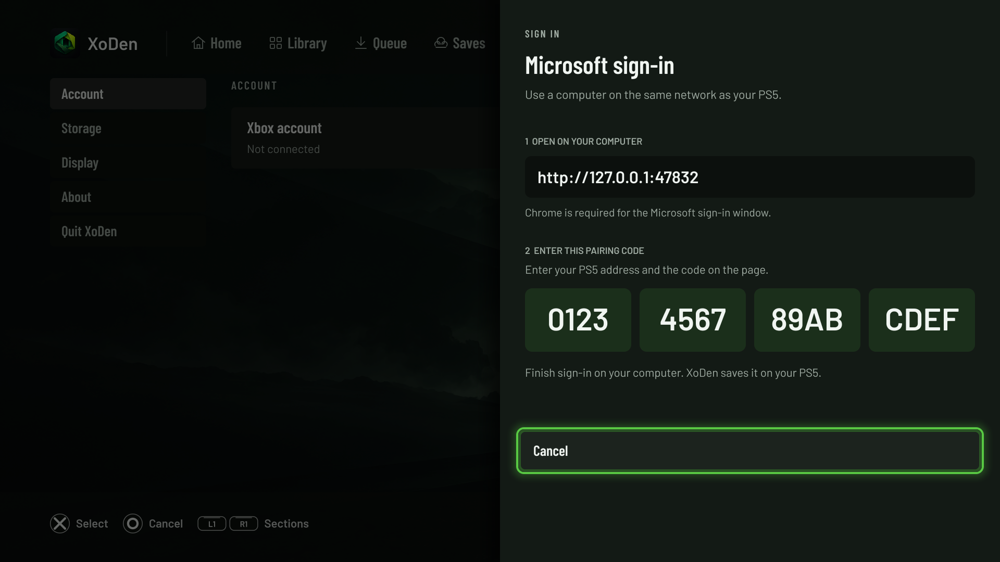

# XoDen 0.1.0



Browse your PC Game Pass library, download Windows games directly to a jailbroken
PS5, and launch each installed game from its own PS5 Home tile.

## Two downloads: PS5 app and computer sign-in helper

1. **[PS5 app — xoden-ps5-0.1.0.zip](https://github.com/griches/xoden_ps5/releases/download/0.1/xoden-ps5-0.1.0.zip)** — install this folder on your PS5.
2. **[Computer helper — xoden-signin-helper-0.1.0.zip](https://github.com/griches/xoden_ps5/releases/download/0.1/xoden-signin-helper-0.1.0.zip)** — run this separately on your computer to sign in to Microsoft.

**The computer helper is required for Microsoft sign-in.** It requires
**Node.js 24+ and Google Chrome**. **macOS is tested; Windows is not verified.**
It is a Node-based helper, not a standalone Windows `.exe`. The release ZIP
includes the built helper, so normal use does not require npm installation.
On Mac, double-click `start.command`; alternatively run `node server.mjs` in
its folder. Open **http://127.0.0.1:47832 on that same computer**, not on a phone.
After sign-in, downloads and games run on the PS5 without the helper.
See [the sign-in steps](#sign-in-with-microsoft) below.

**Very early beta.** Compatibility varies widely: some games work, others fail
at startup or require settings changes. Installing successfully does not mean a
game will run. Check the [compatibility chart](COMPATIBILITY.md) before a large download.

XoDen is an independent project, **not affiliated with or supported by Xodus,
Xodus Nexus, Playden, Microsoft or Xbox**. Please report XoDen problems in
[this repository's Issues](https://github.com/griches/xoden_ps5/issues),
not to those projects' support channels. Their contributions are credited below.
This repository and its release downloads currently require repository access.

**[Download 0.1.0](https://github.com/griches/xoden_ps5/releases/tag/0.1)** ·
**[Compatibility](COMPATIBILITY.md)** · **[Known issues / roadmap](ROADMAP.md)** ·
**[Release notes](CHANGELOG.md)** · **[Build instructions](DEVELOPMENT.md)**

## Requirements

- A jailbroken PS5 with root-helper support. Tested on firmware **13.60**;
  other firmware is unverified.
- **kstuff**, **ShadowMountPlus** and an **ELF loader on port 9021** running
  after each console boot. ShadowMountPlus registers the app and game tiles.
- An FTP server on the PS5 for installation, and working console networking/DNS.
  If your jailbreak uses local DNS, its DNS payload must also be running.
- A Microsoft account with an active **PC Game Pass or Game Pass Ultimate**
  subscription and access to the selected PC edition. XoDen uses Microsoft's
  entitlement and content-licensing checks; games and subscriptions are not included.
- Enough console storage for game files, the runtime kit and a private Windows
  environment per game.
- For Microsoft sign-in: a computer on the same network, **Node.js 24+** and
  **Google Chrome**. The sign-in helper is separate from the PS5 app. macOS is
  the tested computer platform; other helper platforms need testing.

## Install on the PS5

1. Download and unzip `xoden-ps5-0.1.0.zip` from the
   [0.1.0 release](https://github.com/griches/xoden_ps5/releases/tag/0.1).
   `SHA256SUMS` is provided alongside the downloads.
2. Copy the **PPSA99324** folder to **/data/homebrew/PPSA99324** on the PS5
   using FTP. Keep all files and subfolders. This is a homebrew folder, not a
   retail PKG installer.
3. Let ShadowMountPlus register the XoDen tile, then open it from PS5 Home.
4. Accept the first-run runtime-kit download and wait for it to finish.
5. Sign in to Microsoft using the computer helper below, then open Library.

The optional Python uploader is included in the app archive. From its extracted
folder, with XoDen closed, run:

```sh
python3 tools/console_title_deploy.py --host <PS5-IP> --port <FTP-PORT> deploy --install PPSA99324 --backup backups/before-xoden
```

Use your FTP server's actual port. Keep the backup locally; it is not part of a
release or an issue report. XoDen's title ID is **PPSA99324**, separate from
upstream Playden's FAKE77031.

## Sign in with Microsoft

**Open the helper page on the computer running the helper.**
`http://127.0.0.1:47832` means that computer; it is not a page hosted by the PS5.
Entering it on a phone points at the phone and will not reach the helper.

1. Download and unzip `xoden-signin-helper-0.1.0.zip` on your computer.
2. On macOS, double-click `start.command`. Alternatively, open a terminal in
   that folder and run `node server.mjs --open`. Keep the helper running.
3. In XoDen, open **Game Pass account** or **Settings → Xbox account →
   Sign in with Microsoft**. The console shows a pairing code.
4. On the **same computer as the helper**, open
   [http://127.0.0.1:47832](http://127.0.0.1:47832). Enter the PS5's local
   network address and the pairing code shown on the PS5.
5. Complete Microsoft's approval in the separate temporary **Chrome** window.
   The local helper page itself can open in Safari or another browser.
6. Wait for XoDen to confirm sign-in and refresh the library. You can then
   close the helper. It is not needed to keep downloading or playing games;
   start it again if XoDen asks you to sign in again.

The helper relays browser approval; the console performs the account exchange
and saves the session. It does not copy your computer's Xbox wallet or use your
usual Chrome profile. Sign-in persistence, renewal and individual games' account
integration are still being tested. Treat files containing account sessions as
private; do not upload them with reports.



## Download and play

Select a game in **Library**, review the **PC** package and size, and start its
download. **Queue** shows progress and supported pause/resume controls. Pausing
is available during file transfer; setup and preparation are separate phases.
Downloads run on the PS5, not on the computer helper.

After the download, XoDen prepares the game's Windows environment and registers
its PS5 Home tile. If registration stays pending, close XoDen, return to PS5 Home,
wait for the tile, then reopen XoDen. This recovery worked in recent tests;
registration can still stall. Keep the game files and saves while diagnosing it.

Launch from XoDen or the game's PS5 Home tile. Per-game settings include graphics
under **Compatibility**, executable/arguments and library overrides. Settings
that help one game are not a universal fix for another.

LIMBO's verified Game Pass edition gets its required Microsoft shader compiler
and native override automatically in 0.1.0, including existing generated setups.
Users do not need to copy the DLL or enter that override manually.

## Runtime kit and updates

The first-run kit is hosted separately as release assets in the public
[XoDen runtime mirror](https://github.com/griches/xoden-runtime/releases/tag/v0.13.1).
It supplies Wine for PS5, graphics libraries, a clean bottle template and the
per-game PS5 title shell. **Kit 0.13.1 is separate from app version 0.1.0.** It is
based on Playden kit 0.13 with a native launcher lookup fix. Checksums, original
licenses, provenance and exact shell sources accompany the kit release.

Games come from Microsoft's servers through your account, not from this GitHub
repository or the runtime mirror. The app also bundles the pinned Xbox runtime
bridge/modules and Microsoft's unmodified compiler needed by LIMBO, with their
own licenses and source information.

For app updates, close XoDen and copy the new PPSA99324 folder over the existing
app. **In-app app updates are disabled in this beta.** Do not replace the app
while a download or game preparation is running. Keep these shared data folders:

| Location | Contents |
| --- | --- |
| `/data/playden/user/` and `/data/playden/xbox/` | Settings, account state and download records |
| `/data/playden/logs/` | App diagnostics |
| `/data/playden-games/` | Downloaded game files |
| `/data/playden/games/` | Per-game Windows environments, settings, sessions and saves |
| `/data/playden/kits/` | Installed runtime kit |

0.1.0 is XoDen's first release number. Earlier development builds displayed an
inherited Playden 0.7.2 version; that number does not mean they are newer XoDen releases.

## Compatibility and troubleshooting

The [compatibility chart](COMPATIBILITY.md) records the **PC Game Pass edition**,
runtime, settings and actual test coverage. “Launches” means a startup/menu test;
“Works” requires gameplay evidence. Steam results and another edition's results
are not automatically transferable. Please report successful games as well as failures. To propose a chart change,
edit `COMPATIBILITY.md` on a branch and open a pull request, or use the issue
form and let a maintainer update it. See [contributing](CONTRIBUTING.md).

- **Helper page will not open:** start the helper first and open its loopback URL
  on that computer. Install Node.js 24+ and Chrome if missing.
- **Microsoft Store device limit:** unlink an unused device at
  [Microsoft's content devices page](https://account.microsoft.com/devices/content),
  then Resume the download. This is a licensing refusal, not game incompatibility.
  XoDen should reuse the saved console device across games; do not delete account
  data repeatedly to troubleshoot this error.
- **Game downloaded but no tile:** use the registration recovery above and report
  the result. Do not repeatedly download the whole game as the first step.
- **Shader, DirectX or unsupported-GPU error:** check the exact game's chart entry.
  Such errors can be runtime compatibility problems even after a correct install.
- **Remote Play blocks your controller:** disconnect Remote Play and reconnect
  the controller before testing. Remote Play is optional and is not needed by XoDen.

Known limitations include uneven game compatibility, registration delays,
unverified long-term session renewal, some truncated notifications and remaining
storage-inventory acceptance checks. See [ROADMAP.md](ROADMAP.md). Do not assume
Xbox cloud saves or anti-cheat support; only behavior recorded for a game is verified.

## Report issues here

Use [XoDen Issues](https://github.com/griches/xoden_ps5/issues) or the
[compatibility report form](https://github.com/griches/xoden_ps5/issues/new?template=compatibility-report.yml).
Include app version, runtime-kit version, firmware, exact PC game/edition, the last
successful step, settings changes, and a screenshot or redacted log when possible.
Never post session files, tokens, account identifiers, pairing codes, signed
package URLs or private console configuration. In-app ratings are local;
automatic GitHub submission is not implemented. Please do not ask the upstream
Xodus, Nexus or Playden teams to support this fork.

## Source and credits

| Directory | Purpose |
| --- | --- |
| `playden-ps5/` | Console UI, runtime preparation and PS5 registration, derived from Playden |
| `xodus-ps5-backend/` | Active Xodus-derived Rust backend and native PS5 downloader |
| `xodus-games/ps5-extras/signin/` | Separate Microsoft browser sign-in helper, with MIT Nexus-derived adapter |
| `xodus-games/` | Integration tooling and development work record |
| `xodus/` and `xodus-nexus/` | Earlier integration source and pinned upstream provenance |

```sh
git clone --recurse-submodules https://github.com/griches/xoden_ps5.git
```

See [DEVELOPMENT.md](DEVELOPMENT.md), [source provenance](SOURCE-PROVENANCE.json)
and [third-party notices](playden-ps5/THIRD_PARTY_NOTICES.md). Original component
licenses and histories are retained. No games, account sessions, local console
configuration or deployment backups are distributed in the source repository.
